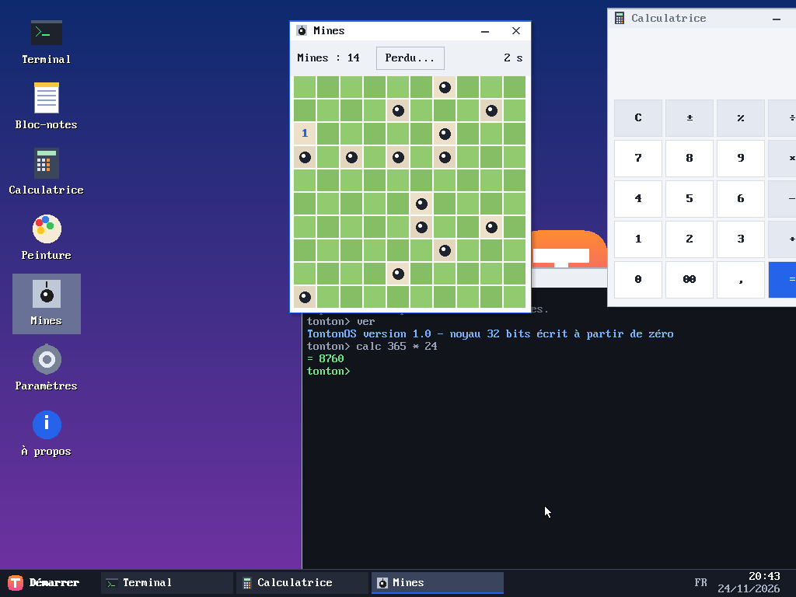
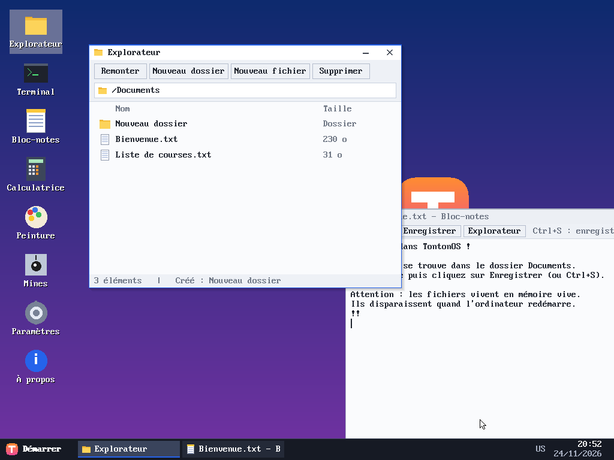

# TontonOS

Un petit système d'exploitation écrit à partir de zéro, en C et en assembleur x86.
Il démarre avec GRUB, passe en mode graphique 1024 × 768 et affiche un bureau
avec des fenêtres, une barre des tâches et un menu Démarrer.



## Ce qu'il sait faire

- Noyau 32 bits en mode protégé : GDT, interruptions, minuterie, horloge CMOS.
- Gestion de la mémoire (allocateur avec libération).
- Pilotes clavier (AZERTY par défaut, QWERTY avec F12, accents et touches mortes ^ ¨)
  et souris PS/2.
- Graphismes : double tampon, police 8 × 16 avec les caractères accentués, ombres, dégradés.
- Fenêtres déplaçables, réduction, fermeture, premier plan au clic.
- Fenêtres redimensionnables par le bord droit, le bord du bas ou le coin (Terminal,
  Bloc-notes, Explorateur), avec bouton Agrandir et double-clic sur la barre de titre.
- Barre des tâches avec horloge, menu Démarrer, icônes du bureau (double-clic).
- Système de fichiers en mémoire avec dossiers (Documents, Images, Système).
  Les fichiers sont perdus au redémarrage.
- Écran bleu en cas d'erreur du processeur.

Applications : Explorateur, Terminal, Bloc-notes (ouvrir, modifier, enregistrer avec Ctrl+S),
Calculatrice, Peinture, Mines, Paramètres (fond d'écran, couleur, clavier) et À propos.



## L'essayer

Le fichier `tontonos.iso` est prêt à l'emploi :

- **VirtualBox** : nouvelle machine « Other / Unknown (32-bit) », 128 Mo de RAM,
  puis insérer `tontonos.iso` comme disque optique.
- **QEMU** : `qemu-system-i386 -cdrom tontonos.iso -m 128M`

Il n'a été testé que dans QEMU. Sur un vrai PC, il faut un démarrage en mode BIOS
(« Legacy » / CSM) et une souris ou un clavier compatibles PS/2.

## Compiler

Sous Ubuntu ou Debian :

```sh
sudo apt install gcc gcc-multilib nasm grub-pc-bin grub-common xorriso mtools qemu-system-x86
make        # produit build/tontonos.iso
make run    # lance QEMU
```

## Organisation du code

| Fichier | Rôle |
|---|---|
| `src/boot.asm` | En-tête Multiboot, pile, chargement GDT/IDT, routines d'interruption |
| `src/kmain.c` | Point d'entrée C : mémoire, écran, pilotes, lancement du bureau |
| `src/interrupts.c` | GDT, IDT, contrôleur d'interruptions, minuterie, horloge, écran bleu |
| `src/input.c` | Clavier et souris PS/2 |
| `src/gfx.c` | Dessin : rectangles, texte, lignes, curseur, copie à l'écran |
| `src/wm.c` | Bureau, fenêtres, barre des tâches, menu Démarrer |
| `src/apps.c` | Les huit applications |
| `src/fs.c` | Système de fichiers en mémoire |
| `src/lib.c` | Chaînes, nombres, allocateur mémoire |
| `src/font.h` | Police générée par `tools/psf2c.py` (police console Lat15-VGA16) |

## Commandes du terminal

`aide`, `effacer`, `echo`, `heure`, `date`, `mem`, `uptime`, `ver`,
`clavier fr|us`, `fond 1-4`, `ouvrir <appli>`, `calc 12 * 7`, `redemarrer`, `eteindre`,
`ls`, `cd`, `pwd`, `cat`, `mkdir`, `touch`, `rm`, `edit`. La touche Tab complète les noms de fichiers.
